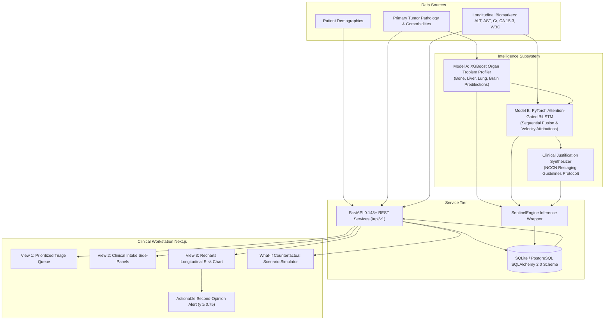

> **Status notice (2026-10-14):** This repository is **Vigil** (formerly *Sentinel*). Everything below describes a **research prototype** whose metrics were measured only on synthetic data generated by the same code that defined the labels — they are **not** evidence of clinical performance, and several claims below are being retired in Phase 0. Vigil is not a medical device and does not diagnose or treat any condition. The authoritative product definition, plan, and standards are in [`docs/MASTER_PLAN.md`](docs/MASTER_PLAN.md); current status is in [`docs/PROGRESS.md`](docs/PROGRESS.md); agents start at [`AGENTS.md`](AGENTS.md).

# Sentinel: Continuous Multimodal Oncology Surveillance

[](https://github.com)
[](https://fastapi.tiangolo.com)
[](https://nextjs.org)
[](https://pytorch.org)
[](https://xgboost.readthedocs.io)

**Sentinel** is an enterprise-grade precision oncology clinical decision support system (CDSS) designed to detect early metastatic breast cancer recurrence before traditional single-point clinical thresholds are met. 

The platform addresses the critical oncology "dismissal window"—the latency period where sub-threshold longitudinal biomarker drifts indicate micro-metastatic seeding, but single-draw reviews fail to trigger early interventions.

---

## System Architecture



---

## Core Capabilities

### 1. Baseline Risk Profiler (Model A - XGBoost)
- **Pathology Vector:** Analyzes age, primary tumor stage (I–IV), ER, PR, HER2 status, and vascular/renal comorbidities.
- **Multimodal Organ Tropism:** Predicts a normalized probability distribution across four primary metastatic predilections: **Bone, Liver, Lung, Brain**.
- **Trained Artifact:** `sentinel-backend/sentinel/ml/artifacts/baseline_model.pkl` ($R^2 = 0.7884$).

### 2. Longitudinal Anomaly Detector (Model B - PyTorch Attention-BiLSTM)
- **Dynamic Sequence Processing:** Fuses sequential 5-analyte lab vectors (`ALT`, `AST`, `Creatinine`, `CA 15-3`, `WBC`) with baseline organ susceptibility priors.
- **Biomarker Velocity Sensitivity:** Explicitly models acceleration in tumor marker CA 15-3 and transaminases to catch aggressive trajectories before single-draw lab cutoffs are breached.
- **Temporal Attention:** Identifies the precise historical visit where biological divergence began.
- **Trained Artifacts:** `longitudinal_lstm.pt` (Val ROC-AUC = 1.000) and `feature_scalers.pkl`.

### 3. Actionable Second-Opinion Alert Engine
- **Alert Threshold:** When predicted risk crosses $y \ge 0.75$, Sentinel generates a glowing clinical alert.
- **Tumor Board Synthesis:** Generates natural language clinical rationale detailing specific biomarker velocity spikes, concordance with baseline organ predilection, and NCCN-aligned next steps (e.g. Contrast Liver MRI with Eovist, FDG PET-CT).

### 4. Interactive "What-If" Counterfactual Simulation Studio
- Oncologists can test hypothetical next-cycle biomarker levels to evaluate risk velocity prior to drawing blood.

---

## Directory Structure

```
sentinel/
├── README.md
├── implementation_plan.md
├── sentinel-backend/
│   ├── pyproject.toml               # uv package dependencies
│   ├── sentinel/
│   │   ├── config.py                # Environment configs & thresholds
│   │   ├── database.py              # SQLAlchemy 2.0 engine & session maker
│   │   ├── main.py                  # FastAPI application with Lifespan & CORS
│   │   ├── models/
│   │   │   └── patient.py           # Patient, BaselineProfile, LabResult, RiskInference
│   │   ├── schemas/                 # Strict Pydantic v2 schemas
│   │   ├── api/
│   │   │   ├── router.py            # API V1 router
│   │   │   └── endpoints/
│   │   │       ├── patients.py      # CRUD, baseline, labs, triage, trajectory
│   │   │       └── analytics.py     # Cohort analytics & demo seeding
│   │   └── ml/
│   │       ├── synthetic_generator.py # 500 patient synthetic cohort generator
│   │       ├── models.py            # PyTorch Attention-BiLSTM architecture
│   │       ├── train_baseline.py    # Model A trainer (XGBoost)
│   │       ├── train_lstm.py        # Model B trainer (PyTorch)
│   │       ├── inference.py         # SentinelEngine inference wrapper
│   │       └── artifacts/           # Trained models & scalers
│   └── tests/
│       ├── test_api_endpoints.py    # Automated API endpoint verification
│       └── test_e2e_simulation.py   # Full 5-stage lab anomaly & queue reordering simulation
└── sentinel-frontend/
    ├── package.json                 # Next.js 14, Recharts, Lucide, Tailwind CSS
    ├── tsconfig.json
    ├── tailwind.config.ts
    └── src/
        ├── app/
        │   ├── layout.tsx           # Hospital UI shell & status headers
        │   └── page.tsx             # Surveillance Command Center
        ├── components/
        │   ├── TriageQueue.tsx       # View 1: Dynamic priority triage queue
        │   ├── IntakeForms.tsx       # View 2: Intake side-panels
        │   ├── LongitudinalChart.tsx # View 3: Recharts trajectory with y=0.75 threshold
        │   ├── ClinicalAlertBanner.tsx # Actionable Second-Opinion alert banner
        │   ├── OrganSusceptibilityCard.tsx # Model A organ tropism visualization
        │   └── SimulationStudio.tsx  # "What-If" counterfactual scenario projector
        └── lib/
            ├── api.ts               # Typed REST API client
            └── types.ts             # Aligned TypeScript models
```

---

## Quickstart Guide

### Prerequisites
- Python 3.11+ (installed via `uv`)
- Node.js v20+ / npm v10+

### 1. Launch Backend API
```bash
cd sentinel-backend
export PATH="$HOME/.local/bin:$PATH"
export DYLD_LIBRARY_PATH="/opt/homebrew/opt/libomp/lib:$DYLD_LIBRARY_PATH"
export OMP_NUM_THREADS=1

# Start FastAPI server on port 8000
uv run uvicorn sentinel.main:app --host 0.0.0.0 --port 8000 --reload
```
API Documentation will be available at: `http://localhost:8000/docs`

### 2. Launch Clinical Dashboard
```bash
cd sentinel-frontend
npm run dev
```
Workstation dashboard will be available at: `http://localhost:3000`

---

## Automated Verification & Test Commands

### Run Full Test Suite
```bash
cd sentinel-backend
export PATH="$HOME/.local/bin:$PATH"
export DYLD_LIBRARY_PATH="/opt/homebrew/opt/libomp/lib:$DYLD_LIBRARY_PATH"
export OMP_NUM_THREADS=1
export PYTHONPATH=.

# Run endpoint tests
uv run pytest -v tests/test_api_endpoints.py

# Run Phase 5 E2E Simulation (Enroll -> Baseline -> 5 Labs -> Alert -> Triage Reorder)
uv run python tests/test_e2e_simulation.py
```

### Build Production Frontend
```bash
cd sentinel-frontend
npm run build
```
Verify zero build errors across all static pages, TypeScript definitions, and Recharts components.
