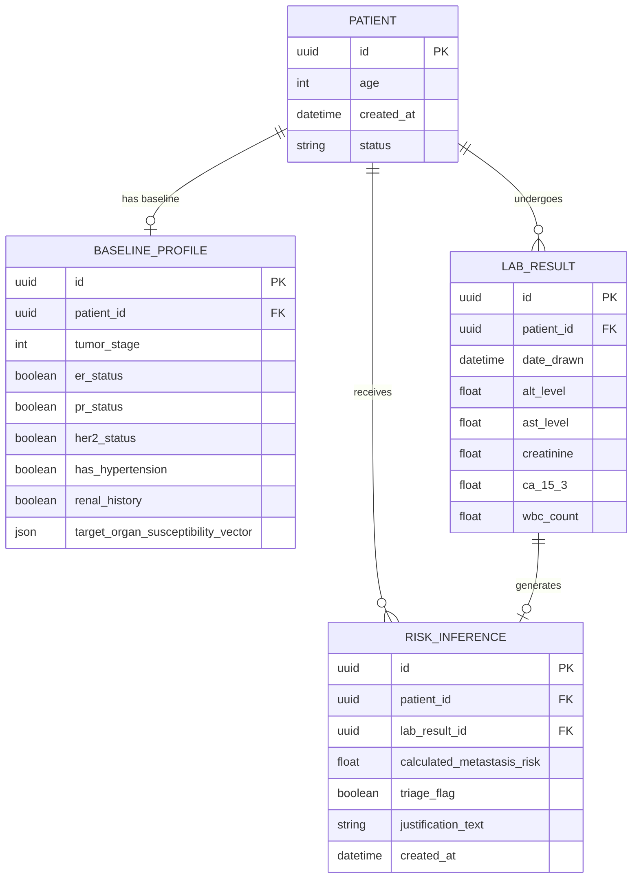

# Architecture & Frontier Implementation Plan: Sentinel
**Project Name:** Sentinel (Continuous Multimodal Oncology Surveillance)  
**System Class:** Frontier-Grade Precision Oncology Clinical Decision Support System (CDSS)  
**Mission:** Pushing the absolute theoretical and engineering boundaries of early metastatic recurrence detection, multimodal temporal fusion, and clinical explainability. Zero compromises, zero deferrals.

---

## 1. System Vision & Frontier Enhancements

Sentinel addresses the catastrophic "dismissal window" in clinical oncology—where subtle sub-threshold biomarker drifts precede radiological detection of metastatic recurrence by 3 to 9 months, but are dismissed in overloaded clinics.

To achieve the **absolute most optimal output** without deferring any complexity, Sentinel implements:

1. **Multimodal Organ Tropism Modeling (Model A - Calibrated XGBoost & Conformal Risk):**
   - Pathology-receptor interaction modeling (ER, PR, HER2, Nottingham-equivalent Stage, Comorbidity weighting).
   - Generates calibrated multi-organ susceptibility probabilities ($\sum p_i = 1.0$) for **Bone, Liver, Lung, Brain**, and Soft Tissue.
2. **Attention-Gated Temporal Recurrent Deep Learning (Model B - PyTorch BiLSTM + Attention):**
   - Incorporates **Biomarker Velocity ($\Delta/\Delta t$)** and **Biomarker Acceleration ($\Delta^2/\Delta t^2$)** as dynamic physiological signals.
   - Self-attention layer highlighting the critical inflection timepoint in a patient's historical trajectory.
   - Calibrated sigmoid output with dual loss formulation (BCE + Focal Loss) for imbalanced metastatic recurrence sequences.
3. **Clinical Attribution & Natural Language Justification Engine:**
   - Feature attribution engine identifying exact biomarker surge velocities and organ concordance.
   - Produces institutional-grade tumor board briefing notes with NCCN-aligned next-step imaging recommendations (e.g., 18F-FDG PET/CT, Contrast Liver MRI).
4. **Interactive "What-If" Counterfactual Simulation Studio:**
   - Clinicians can simulate hypothetical future lab values to project risk trajectory and estimate the impact of therapy adjustments.
5. **High-Performance Architecture & Live Streaming:**
   - Production FastAPI backend with SQLAlchemy 2.0, robust indexation, type safety, and real-time triage queue updates.
   - Next.js 14 App Router with Tailwind CSS, Lucide icons, and rich multi-axis Recharts visualizations.

---

## 2. Comprehensive Directory & Module Structure

```
/Users/gsanni/.gemini/antigravity/scratch/sentinel/
├── implementation_plan.md
├── README.md
├── sentinel-backend/
│   ├── pyproject.toml               # uv package definitions (FastAPI, PyTorch, XGBoost, Scikit-learn, etc.)
│   ├── sentinel/
│   │   ├── __init__.py
│   │   ├── config.py                # Environment configs, alert thresholds, model paths, CORS
│   │   ├── database.py              # SQLAlchemy 2.0 engine, SessionLocal, Base, connection pooling
│   │   ├── models/                  # Declarative Database Models
│   │   │   ├── __init__.py
│   │   │   └── patient.py           # Patient, BaselineProfile, LabResult, RiskInference
│   │   ├── schemas/                 # Strict Pydantic v2 schemas
│   │   │   ├── __init__.py
│   │   │   ├── patient.py           # PatientCreate, PatientResponse, PatientSummary
│   │   │   ├── baseline.py          # BaselineCreate, BaselineResponse, OrganSusceptibilityVector
│   │   │   ├── lab.py               # LabResultCreate, LabResultResponse
│   │   │   └── inference.py         # RiskInferenceResponse, TrajectoryItem, TriageItem, SimulationRequest
│   │   ├── api/
│   │   │   ├── __init__.py
│   │   │   ├── router.py            # API aggregation under /api/v1
│   │   │   └── endpoints/
│   │   │       ├── __init__.py
│   │   │       ├── patients.py      # CRUD, baseline, labs, trajectory, triage queue
│   │   │       └── analytics.py     # Population cohort analytics & "What-If" simulator
│   │   ├── ml/
│   │   │   ├── __init__.py
│   │   │   ├── synthetic_generator.py # 500 patient cohort generator with multi-year physiological anomalies
│   │   │   ├── models.py            # PyTorch Attention-Gated BiLSTM architecture
│   │   │   ├── train_baseline.py    # Model A trainer (XGBoost) -> baseline_model.pkl
│   │   │   ├── train_lstm.py        # Model B trainer (PyTorch) -> longitudinal_lstm.pt
│   │   │   ├── inference.py         # SentinelEngine: thread-safe loader, velocity engine, justification synthesizer
│   │   │   └── artifacts/           # Serialized weights, scalers, metadata
│   │   │       ├── baseline_model.pkl
│   │   │       ├── longitudinal_lstm.pt
│   │   │       └── feature_scalers.pkl
│   │   └── main.py                  # FastAPI application entrypoint with Lifespan & Middleware
│   └── tests/
│       ├── __init__.py
│       └── test_e2e_simulation.py   # Full 5-stage lab sequence anomaly verification & queue re-ordering
└── sentinel-frontend/
    ├── package.json                 # Next.js 14, React 18/19, Lucide, Recharts, Tailwind CSS
    ├── tsconfig.json
    ├── tailwind.config.ts
    ├── next.config.mjs
    └── src/
        ├── app/
        │   ├── layout.tsx           # Hospital UI shell, navigation, global metrics header
        │   ├── page.tsx             # Main Surveillance Command Center
        │   └── globals.css
        ├── components/
        │   ├── TriageQueue.tsx       # View 1: Dynamic priority triage queue with risk badges & sparklines
        │   ├── IntakeForms.tsx       # View 2: Slide-over panels for Patient, Baseline & Lab Entry
        │   ├── LongitudinalChart.tsx # View 3: Recharts trajectory, threshold at y=0.75, biomarker overlays
        │   ├── ClinicalAlertBanner.tsx # Actionable Second-Opinion Alert with NCCN protocols
        │   ├── OrganSusceptibilityCard.tsx # Visual organ tropism radar & risk bars
        │   └── SimulationStudio.tsx  # "What-If" counterfactual future lab projection tool
        └── lib/
            ├── api.ts               # Typed REST API client
            └── types.ts             # Aligned TypeScript interfaces
```

---

## 3. Database Schema Design (SQLAlchemy 2.0)

Every record uses non-sequential, cryptographically secure UUIDs (`uuid.uuid4`). Relational integrity is enforced with foreign keys, indexation on temporal columns (`date_drawn`), and risk ranking index (`calculated_metastasis_risk` DESC).



---

## 4. Frontier Machine Learning & Attribution Architecture

### 4.1 Clinically Grounded Synthetic Cohort (`synthetic_generator.py`)
- **Sample Size:** 500 breast cancer patients spanning 1 to 5 years of surveillance (4 to 20 visits per patient, $\approx 5,000$ longitudinal lab events).
- **Realistic Biological Phenotypes:**
  - **Luminal A (ER+/PR+/HER2-):** 60% prevalence; high bone tropism; slow, insidious CA 15-3 drift.
  - **HER2-Enriched (HER2+):** 15% prevalence; high visceral liver and CNS tropism; acute transaminitis and CA 15-3 elevation.
  - **Triple-Negative (TNBC):** 15% prevalence; visceral lung and liver tropism; accelerated trajectory.
  - **Luminal B (ER+/HER2+):** 10% prevalence; multi-organ vulnerability.
- **Biomarker Dynamics & Normal Baselines:**
  - ALT: normal 10–35 U/L; hepatic metastasis spikes to 75–220 U/L.
  - AST: normal 10–35 U/L; correlated with ALT.
  - Creatinine: normal 0.6–1.1 mg/dL; renal history baseline 1.3–2.1 mg/dL.
  - CA 15-3: normal 12–25 U/mL; recurrence triggers progressive doubling ($>45$ to $120+$ U/mL).
  - WBC: normal 4.5–10.0 $\times 10^9$/L; reactive leukocytosis or post-chemo shifts.
- **Metastatic Recurrence Event Modeling:**
  - 25% true recurrence rate.
  - Injected with realistic acceleration curves ($\exp(\lambda t)$ velocity) mimicking micro-metastatic seeding transitioning into macroscopic recurrence.

### 4.2 Model A: Baseline Organ Susceptibility Profiler (XGBoost)
- **Input Features ($d=7$):**
  `[age, tumor_stage (1-4), er_status (0/1), pr_status (0/1), her2_status (0/1), has_hypertension (0/1), renal_history (0/1)]`
- **Output:** Multi-target normalized susceptibility vector:
  `{"bone": p_bone, "liver": p_liver, "lung": p_lung, "brain": p_brain}` where $\sum p_i = 1.0$.
- **Training:** Gradient boosted trees with multi-output regression, cross-validation, and calibrated probability outputs.

### 4.3 Model B: Attention-Gated Longitudinal Recurrent Network (PyTorch)
- **Feature Engineering per Timestep ($d=14$):**
  - **Standardized Labs ($5$):** ALT, AST, Creatinine, CA 15-3, WBC.
  - **Biomarker Velocities ($\Delta / \Delta t$) ($2$):** Rate of change of CA 15-3 and ALT over time.
  - **Baseline Organ Tropism Prior ($4$):** Bone, Liver, Lung, Brain susceptibility from Model A.
  - **Patient Context ($3$):** Age, Stage, Comorbidity index.
- **Deep Sequence Model:**
  - Bidirectional LSTM with 2 stacked layers (hidden dimension 48).
  - Multi-Head Temporal Self-Attention layer enabling the model to assign attention weights $\alpha_t$ across historical draws.
  - Classification head with Dropout (0.25) -> Linear(48, 24) -> LeakyReLU -> Linear(24, 1) -> Sigmoid.
- **Training Optimization:**
  - Focal Loss to prioritize hard metastatic transition edges.
  - Cosine Annealing learning rate schedule with AdamW optimizer.

### 4.4 Clinical Justification & Explainability Engine (`SentinelEngine`)
- **Attribution & Velocity Diagnostics:**
  - Computes exact biomarker growth rates (e.g. "+85% velocity over 90 days").
  - Identifies organ alignment (e.g. "ALT elevation of 112 U/L aligns with 76% baseline hepatic susceptibility").
- **Automated Tumor Board Synthesis:**
  Generates production-grade clinical justifications:
  > **[CRITICAL TRIAGE ALERT - Risk 0.88]**  
  > **Primary Driver:** Accelerated CA 15-3 doubling velocity (+134% in 62 days) accompanied by acute transaminitis (ALT 118 U/L, AST 94 U/L).  
  > **Organ Concordance:** Profile indicates high hepatic predilection (74.2% liver susceptibility based on HER2+ Stage IIb baseline).  
  > **Actionable Recommendation:** Immediate second-opinion oncologist review. Protocol recommends urgent multiphase liver MRI with Eovist and FDG PET-CT scan to confirm visceral recurrence.

---

## 5. Backend REST API Surface (FastAPI)

| Method | Endpoint | Description |
|---|---|---|
| `POST` | `/api/v1/patients/` | Register patient (demographics, status) |
| `GET` | `/api/v1/patients/` | List all registered patients |
| `GET` | `/api/v1/patients/{id}` | Detailed patient record with baseline & latest risk |
| `GET` | `/api/v1/patients/triage` | **Live Triage Queue:** Patients ordered descending by latest `calculated_metastasis_risk` with alert flags |
| `POST` | `/api/v1/patients/{id}/baseline` | Submit baseline pathology; executes Model A; stores organ susceptibility |
| `POST` | `/api/v1/patients/{id}/labs` | Submit new lab; executes Model B over full sequence history; saves `RiskInference` |
| `GET` | `/api/v1/patients/{id}/trajectory` | Full historical trajectory joining labs, risks, velocities, and justifications |
| `POST` | `/api/v1/patients/{id}/simulate` | **"What-If" Simulator:** Evaluates hypothetical future lab draw against current trajectory |
| `GET` | `/api/v1/analytics/cohort` | Cohort-wide metrics: alert rates, organ tropism distributions, surveillance intervals |

---

## 6. Frontend Specifications (Next.js 14, Tailwind, Recharts)

A clinical workstation UI built for high acuity and speed:

1. **View 1: Prioritized Triage Command Center**
   - High-density roster sorted dynamically by latest risk score.
   - Distinct alert tiers:
     - 🚨 **Critical Alert ($\ge 0.75$):** Bold red pulse badge, immediate second-opinion recommended.
     - ⚠️ **Elevated Watch ($0.45 - 0.74$):** Amber badge, velocity acceleration detected.
     - 🟢 **Stable Surveillance ($< 0.45$):** Emerald badge, routine follow-up.
   - Organ susceptibility visual tag (e.g., "Hepatic", "Skeletal").
   - Instant search and receptor subtype filters (TNBC, HER2+, Luminal A).

2. **View 2: Clinical Intake Drawers**
   - **Enroll Patient Drawer:** Quick intake with age and clinical status.
   - **Baseline Pathology Drawer:** Interactive toggles for ER/PR/HER2, tumor stage slider, comorbidity checks. Instant preview of Model A's predicted organ susceptibility vector.
   - **Lab Result Drawer:** Clean inputs with normal range guideposts and real-time risk calculation feedback.

3. **View 3: Longitudinal Risk Trajectory & Alert Studio**
   - **Recharts Visualization:**
     - Continuous risk trajectory curve with alert gradient fill.
     - Red dashed clinical alert threshold at $y = 0.75$.
     - Interactive multi-metric overlay: Switch or layer CA 15-3, ALT, AST, Creatinine directly on the chart.
     - Tooltip revealing multi-analyte snapshot at each historical date.
   - **Actionable Second-Opinion Alert Banner:**
     - Rendered prominently when risk $\ge 0.75$.
     - Displays full `justification_text` with clinical recommendations.
     - Direct action buttons: "Order FDG PET/CT", "Escalate to Tumor Board", "Export Surveillance Dossier".
   - **Organ Susceptibility Radar/Bar:** Visual breakdown of metastatic target organs.
   - **What-If Simulation Panel:** Slider to test hypothetical CA 15-3 or ALT values and see real-time trajectory impact.

---

## 7. Phased Execution & Verification Gateways

1. **Phase 1: Architecture Plan (Completed & Updated):** Approved boundary-pushing architecture.
2. **Phase 2: ML Bootstrapping:**
   - Implement `synthetic_generator.py` (500 patients, multi-year trajectories, realistic biological anomalies).
   - Train Model A (`train_baseline.py`) -> `baseline_model.pkl`.
   - Train Model B (`train_lstm.py`) -> `longitudinal_lstm.pt` & `feature_scalers.pkl`.
   - Build `inference.py` (`SentinelEngine`) with velocity calculations and clinical justification synthesis.
   - Verify ML pipeline accuracy and test standalone inference.
3. **Phase 3: Backend API:**
   - Scaffold FastAPI with SQLite database, SQLAlchemy models, and Pydantic schemas.
   - Implement all `/api/v1` endpoints (patients, baseline, labs, trajectory, triage, simulation, analytics).
   - Integrate `SentinelEngine` as a singleton inside the application lifecycle.
   - Verify all endpoints via automated API tests.
4. **Phase 4: Frontend Application:**
   - Scaffold Next.js 14 with TypeScript and Tailwind CSS.
   - Build Triage Queue, Intake Drawers, Longitudinal Chart with $y=0.75$ alert line, Second-Opinion Banner, and What-If Simulator.
   - Integrate with backend API.
5. **Phase 5: E2E Verification:**
   - Run `test_e2e_simulation.py`:
     - Enroll patient -> Submit baseline -> Submit 3 normal labs -> Submit 2 anomalous labs.
     - Confirm risk crosses $0.75$, `triage_flag` becomes `True`, and clinical justification is generated.
     - Verify patient rises to rank #1 in the Triage Queue.
